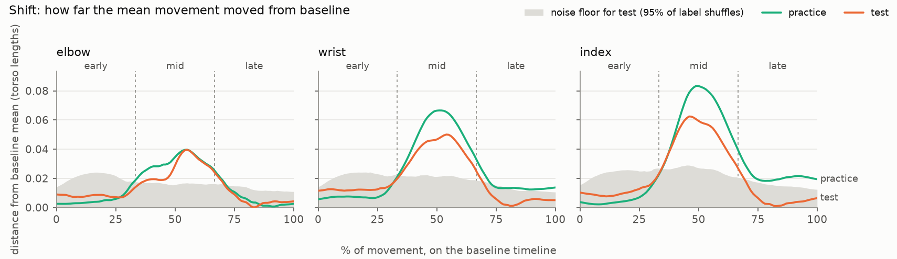
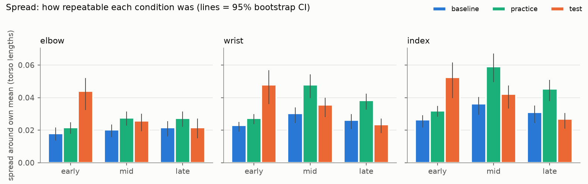
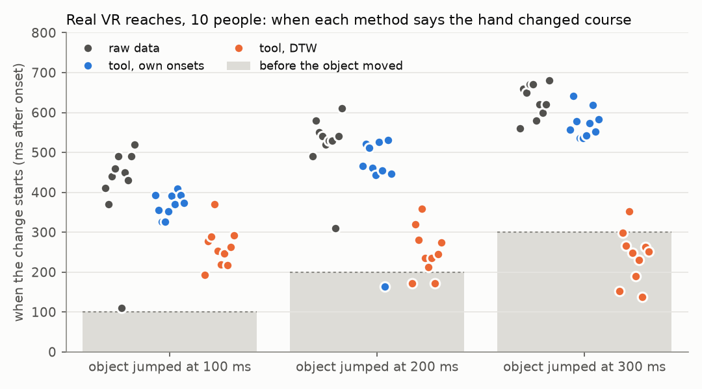

# movement-diff

Measures how a person's movement changes between two conditions, from ordinary phone video. It reports where in the movement the change happens, how big it is, and whether it's a shift or a loss of consistency.

## Why

Headsets get depth wrong. Reaching for targets along the depth axis is slower and less accurate in VR than in the physical world (Barrera Machuca & Stuerzlinger, 2019). Practise a reach in a headset and your arm may learn that wrong depth, then carry it back into the real world.

Studies of this usually measure outcomes: movement time, error, hits. An outcome can show that performance dropped. It can't show what went wrong in the movement.

Take two people whose accuracy dropped by the same amount after VR practice:

- **Person A** reaches as before until the last moment, then stops a few centimetres short every time. The arm has learned the headset's depth error. The fix is in the headset.
- **Person B** is right on average but different every time. The fix is in the training.

Same score, opposite fixes. movement-diff tells them apart by comparing the whole path of the movement, not just the result, and splitting the change in two:

```
mean squared distance from baseline = shift² + spread²
```

**Shift** is how far the average movement moved. **Spread** is how inconsistent the reps became. Both are reported per joint and per phase of the movement: early, mid and late.

Motion capture can measure whole movements too, but it needs a lab. movement-diff needs one phone camera. Filmed from the side, it sees the forward-back axis of a reach, which is the depth axis where headsets cause the most trouble.

## How it works

1. **Pose.** MediaPipe marks shoulder, elbow, wrist and finger in every frame, on a laptop CPU. If positions already come from a headset, motion capture or a tablet, `movediff import` reads them from a CSV and this step is skipped.
2. **Reps.** Wrist speed is used to cut the video into reps. Positions are measured from the shoulder and scaled by torso length, so where the person sat doesn't matter.
3. **Alignment.** No two reps take the same time. Dynamic time warping lines them up so the same moment of the movement is compared across reps.
4. **Comparison.** At each point along the movement it computes shift and spread against baseline, plus endpoint, movement time and speed. Each number is checked against a noise floor from 2000 label shuffles, so differences that luck alone would produce aren't reported as findings.

## Does it work?

It was tested on a simulated arm with known changes planted in the test session. Run `python -m movediff demo` to reproduce it. `pytest` checks the results.

| Planted | Found |
|---|---|
| Path bends in the middle of the reach | Shift of about 2 cm in the mid phase, nearly 4× the noise floor (p<0.001). Nothing early or late. |
| Extra wobble at the start | Spread doubled early (p<0.001), normal elsewhere |
| Slower reaches | Movement time +0.09 s (p<0.001) |
| Same endpoint | No endpoint change (p=0.52) |

The last row is the point. A score based on where the reach ends sees nothing, yet the movement changed in two ways.





Testing also chose the alignment method and caught three bugs that would have produced false results on real data. One example: aligning reps by position hides a reach that stops short, which is exactly the VR depth case. Details are in [validation/](validation/).

## On real VR data

A simulated arm only shows the method recovers what I planted. To check it on real people, I used a public dataset (Furmanek et al., 2022, CC0). Ten people reached for a virtual object in an Oculus Rift while motion capture tracked the hand. On some reaches the object jumped from 20 cm to 40 cm away, 100, 200 or 300 ms after the reach began.

The jump time is known, so the answer is too. Jumped reaches should match normal ones until after the jump, then pull away, and later jumps should show up later. The reference is a plain analysis of the raw positions on the dataset's own clock, with no alignment at all.



| | Raw data | Tool, `--align-on onset` | Tool, default DTW |
|---|---|---|---|
| Change found before the object moved (of 30) | 0 | 1 | 11 |
| Later jump read later (of 10 people) | 9 | 9 | 0 |
| Fires on random halves of normal reaches | 4% | 4% | |

- **Comparing reps at the same milliseconds after onset works.** It gets the order right and almost never reads a change too early. It reads changes a median of 70 ms earlier than the raw data, partly because lining each reach up on its own start narrows the noise band. Given the dataset's own onset times instead, it matches the raw data within 12 ms in 29 of 30 cases.
- **The default DTW fails here.** Jumped reaches took 1.4 to 2.3 times as long, so the same percentage of the movement is a different moment in each. The tool warns when durations differ by more than 25% and points to `--align-on onset`.
- **Going from one person to ten found a bug.** The onset threshold was scaled to each reach's own peak speed, so the faster corrective reaches were cut later and the tool read changes up to 350 ms too early. It's fixed, and a test covers it.

Details and every participant are in [validation/](validation/README.md#real-vr-data).

## The experiment

One person, three blocks, filmed side-on:

1. **Baseline.** 20 reaches to a target.
2. **Practice.** 40 reaches, seeing the hand only through a phone screen that shows it in the wrong place. It is a cheap stand-in for a headset's distorted view.
3. **Test.** 20 reaches straight after, with the phone removed.

If test differs from baseline, the arm kept something it learned from the wrong view. This is a known effect in motor adaptation research (Krakauer & Mazzoni, 2011), which makes it a good check of whether the tool can find a real change inside a movement. The full protocol is in [PROTOCOL.md](PROTOCOL.md).

## Results from the experiment

Pending.

## Run it

```bash
pip install -e ".[dev]"
pytest
python -m movediff demo            # simulated sessions -> results/synthetic/
```

On real video, one file per block:

```bash
python -m movediff extract data/baseline.mp4 data/practice.mp4 data/test.mp4 --overlay
python -m movediff segment work/baseline.pose.npz --expect 20    # repeat for practice and test
python -m movediff analyse --baseline trajectories/baseline.reps.npz \
    --practice trajectories/practice.reps.npz --test trajectories/test.reps.npz \
    --unit-cm 48 --out-dir results/real
```

Check the segmentation plots in `trajectories/` before analysing. `--unit-cm` is your measured shoulder-to-hip length. Each command takes `--help`.

From a CSV of positions instead, with columns `condition,trial,t,joint,x,y`:

```bash
python -m movediff import positions.csv --unit cm --effector wrist   # --onset-at-zero if t=0 marks onset
python -m movediff analyse --baseline trajectories/<a>.reps.npz --test trajectories/<b>.reps.npz
```

To rerun the real-data check, which downloads about 110 MB of the 2.9 GB [dataset](https://doi.org/10.6084/m9.figshare.13377506.v2):

```bash
python validation/fetch_furmanek2022.py
python validation/furmanek2022.py data/furmanek2022/Full_Dataset/Dist_Pert/P*
```

## Limits

- **One person, no ethics approval.** This is a tool, not a study. The statistics say whether this person's movement changed, not whether people's would.
- **2D only.** It uses one side camera. MediaPipe's depth estimate is too noisy to use, so movement toward or away from the camera is invisible.
- **A phone screen is not a headset.** It reproduces the wrong visual information, but not stereo depth, field of view or latency.
- **No control block yet.** Practice or fatigue could explain a difference. The protocol includes a control.
- **Many comparisons, uncorrected p-values.** The protocol fixes one primary measure before recording.
- **The simulation tests the method, not the tracking.** It can't show that MediaPipe follows a real arm well. The overlay video is the check for that.
- **The timeline depends on the comparison.** DTW suits two versions of the same movement. When one condition takes much longer, use `--align-on onset`. The real-data check covers ten people and one kind of change, a jump in target distance, and on it the tool reads timing about 70 ms early.

## References

- Barrera Machuca, M., & Stuerzlinger, W. (2019). The effect of stereo display deficiencies on virtual hand pointing. *Proceedings of the CHI Conference on Human Factors in Computing Systems*.
- Bazarevsky, V., et al. (2020). BlazePose: On-device real-time body pose tracking. arXiv:2006.10204.
- Flash, T., & Hogan, N. (1985). The coordination of arm movements: an experimentally confirmed mathematical model. *Journal of Neuroscience*, 5(7), 1688-1703.
- Furmanek, M. P., Mangalam, M., Yarossi, M., Lockwood, K., & Tunik, E. (2022). A kinematic and EMG dataset of online adjustment of reach-to-grasp movements to visual perturbations. *Scientific Data*, 9, 23.
- Keogh, E. J., & Pazzani, M. J. (2001). Derivative dynamic time warping. *SIAM International Conference on Data Mining*.
- Krakauer, J. W., & Mazzoni, P. (2011). Human sensorimotor learning: adaptation, skill, and beyond. *Current Opinion in Neurobiology*, 21(4), 636-644.
- Sakoe, H., & Chiba, S. (1978). Dynamic programming algorithm optimization for spoken word recognition. *IEEE Transactions on Acoustics, Speech, and Signal Processing*, 26(1), 43-49.

MIT license.
