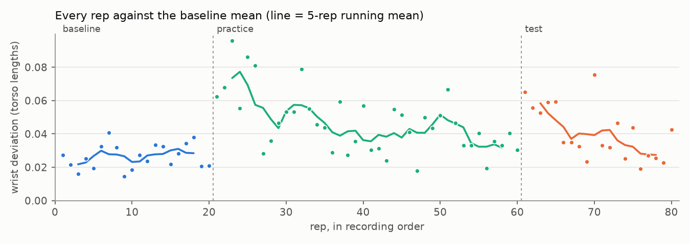

# movement-diff

Give it video of one person doing the same movement under two conditions. It tells you how the movement changed: where in the movement, by how much, and whether the change is a shift or a loss of consistency. Every number comes with a check against chance.

It runs on a laptop CPU from ordinary phone video. No motion capture, no headset, no paid APIs.

## Why

Studies of training in VR usually measure outcomes: score, accuracy, completion time, questionnaires. Those say performance changed. They don't say what changed in the movement, or where in the movement it went wrong.

An accuracy score also mixes two different failures. Measured against a baseline, the mean squared error of a set of reps splits exactly into two parts:

```
mean squared distance from baseline = shift² + spread²
```

Shift is how far the average movement moved. Spread is how much the reps scatter around their own average. A learner who is consistent but offset and a learner who is right on average but erratic can get the same score. They need different fixes. This tool reports the two parts separately, per joint and per phase of the movement.

The motivating question comes from VR training research. If you practise a precision movement with the wrong visual information, as in a headset with distorted depth, does the movement keep a trace of that distortion once the distortion is gone? And if it does, which part of the movement carries it?

## What it reports

For each condition against baseline, per joint (elbow, wrist and index finger by default) and per phase (early, mid and late thirds of the movement by default):

- **Shift.** Distance between the condition's mean path and the baseline mean path, and the share of the total shift that sits in each phase.
- **Spread.** RMS distance of the reps from their own condition's mean, and its ratio to baseline.
- **Velocity profile.** Movement time, peak speed, time to peak speed, speed peaks per rep, and the mean speed curve.
- **Endpoint.** Where the effector stops. This is the closest thing here to an outcome score. It is reported so you can see what it misses.

Checks against chance:

- **Shift.** The condition labels are shuffled between reps 2000 times. The average shuffled value is the noise floor. The p-value is the fraction of shuffles at least as large as the real shift.
- **Spread.** A bootstrap 95% CI on the ratio, and a permutation test on residuals. Each condition is centred on its own mean first, so a shift can't leak into the spread test.
- **Two sanity checks on every run.** Baseline first half against second half, which should show nothing. And the shift recomputed with linear time instead of DTW. If that one is much larger, part of the change is timing rather than path.

Output goes to `summary.md` (tables), `metrics.json` (every number) and four figures.

## Does it measure what it says?

Before recording anyone, I ran the whole pipeline on synthetic sessions where the answer is known. [`movediff/synth.py`](movediff/synth.py) simulates a two-link arm making minimum-jerk reaches (Flash & Hogan, 1985), with landmark jitter, rep-to-rep timing differences and a camera that moves between sessions. It then injects specific changes into the test session. `python -m movediff demo` reproduces the numbers below and [`tests/test_synthetic.py`](tests/test_synthetic.py) asserts them.

Units are torso lengths. A torso is roughly 50 cm, so 0.04 is about 2 cm.

| Injected into the test session | Reported for the wrist |
|---|---|
| Path bulges sideways mid-reach. Peak at 50% of the movement, gone by the end, fading over the 20 test reps. | Mid-phase shift 0.040 against a noise floor of 0.011, p<0.001. 86% of the total shift sits mid, peak at 54%. Early and late not significant, p=0.29 and p=0.26. |
| Extra rep-to-rep variability in the first 40% of the reach only | Spread ratio early 2.12 [1.61, 2.69], p<0.001. Mid 1.13, p=0.30. Late 0.87, p=0.30. |
| Slower reaches, 0.92 s against 0.80 s | Movement time +0.09 s, Hedges g = 1.40, p<0.001 |
| The bulge fades across test reps | First 5 test reps, mid shift 0.071. Last 5, 0.026. |
| No change in where the reach ends | Endpoint moved 0.005, p=0.54 |
| Camera 25 px to the side and 4% closer | Removed by normalisation |
| Nothing. Baseline first half against second half. | No shift in any phase, all p ≥ 0.6 |

The endpoint row is the reason the tool exists. An outcome measure sees no change. The trajectory shows a large change in the middle of the movement and a doubling of variability at the start.




### Choosing how to line reps up

No two reps take the same time, so they have to go onto a shared timeline before they can be compared point by point. How that's done changes the answer. I tested four options on two synthetic changes and on a pure timing change, six seeds each. The script is [`validation/benchmark_alignment.py`](validation/benchmark_alignment.py) and the full table is in [`validation/alignment_benchmark.md`](validation/alignment_benchmark.md).

| Alignment | Error on bulge | Error on undershoot | Undershoot, mid phase (true 0.031) | Timing change left over |
|---|---|---|---|---|
| Linear time, 0-100% | 0.009 | 0.008 | 0.030 | 100% |
| DTW on joint position | 0.007 | 0.026 | 0.005 | 1-3% |
| DTW on joint velocity, the default | 0.010 | 0.012 | 0.030 | 20-23% |
| DTW on joint speed | 0.011 | 0.018 | 0.048 | 32-35% |

Error is the RMS gap between the reported and the injected shift curve, in torso lengths.

- Position DTW is the most accurate on the bulge and on timing, but it erases most of an undershoot. It slides the short reach along the long one until they match. A reach that stops short is what depth compression in a headset would produce, so this is the failure I can least afford.
- Linear time is accurate on both spatial changes, but it reports all of a timing change as a change in path. A slower, more careful deceleration after practice would show up as a fake shift.
- Velocity DTW is the only option that holds up on all three. It is a little noisier, and it over-reads the end of an undershoot by about 18%.

No option wins everywhere, so the summary prints the linear-time shift beside the DTW shift. If they agree, the change is in the path. If the linear one is much bigger, some of it is timing.

### What the validation caught

The synthetic check found three problems that would otherwise have gone straight into real results.

1. **Fidgets counted as reps.** A small twitch passed the speed threshold. Candidates that travel less than half the session's median path are now rejected, and every rejection is marked on the segmentation plot.
2. **More variability looked like a shift.** Extra sideways wobble at the start of a reach pushed speed over the threshold earlier, so test reps were cut longer than baseline reps. That misalignment produced a significant fake shift in the mid and late phases. Reps are now cut on speed along the movement's main direction.
3. **An averaged template had a lumpy speed profile.** Warping stretches time, so the mean of warped reps had bumps no real reach has, and every rep was then aligned to the bumps. The target is now the medoid baseline rep, retimed to average baseline timing.

## The experiment

The full protocol is in [PROTOCOL.md](PROTOCOL.md). One person, one sitting, three blocks, filmed side-on:

1. **Baseline.** 20 reps.
2. **Perturbed practice.** 40 reps, seeing the hand only through a phone screen whose view is displaced from where the hand really is. It is a cheap stand-in for a headset's perceptual offset.
3. **Test.** 20 reps straight after, perturbation removed.

If test differs from baseline, the movement kept a trace of a distortion that is no longer there. This is the aftereffect of sensorimotor adaptation (Krakauer & Mazzoni, 2011). That makes it a good test signal: the effect is known to exist, so the open question is whether the instrument can locate it inside the movement.

## Results on recorded data

Pending. The three blocks get recorded next, and this section will hold the same tables and figures for real video.

## Run it

```bash
git clone <this repo> movement-diff && cd movement-diff
python -m venv .venv && source .venv/bin/activate
pip install -e ".[dev]"

pytest                      # synthetic checks, about 10 s
python -m movediff demo     # synthetic sessions -> results/synthetic/
```

On real video, one file per block:

```bash
python -m movediff extract data/baseline.mp4 data/practice.mp4 data/test.mp4 --overlay
python -m movediff segment work/baseline.pose.npz --side right --expect 20
python -m movediff segment work/practice.pose.npz --side right --expect 40
python -m movediff segment work/test.pose.npz --side right --expect 20
python -m movediff analyse --baseline trajectories/baseline.reps.npz \
    --practice trajectories/practice.reps.npz --test trajectories/test.reps.npz \
    --unit-cm 48 --out-dir results/real
```

Look at `trajectories/*.segmentation.png` before analysing. If a fidget got counted, drop it with `--drop 7` and run segment again. The first extract downloads MediaPipe's pose model, 9 MB, into `models/`. Every option is listed under `python -m movediff <command> --help`.

## How it works

- **Pose.** MediaPipe Pose Landmarker, full model, 33 landmarks per frame (Bazarevsky et al., 2020). Only image x and y are used.
- **Clean-up.** Landmarks under 0.5 visibility are dropped. Gaps up to 0.25 s are interpolated, and longer gaps disqualify any rep they touch. Variable-frame-rate phone video is resampled to a fixed rate. A zero-lag 4th-order Butterworth low-pass at 6 Hz, the usual choice for human movement (Winter, 2009), removes jitter. Raise it with `--cutoff` for fast throws.
- **Normalisation.** The moving-side shoulder is subtracted every frame. Positions are divided by one median shoulder-to-hip length per session, or upper arm plus forearm if the hip is hidden. x is flipped so forward is positive. Pass your measured torso length with `--unit-cm` to get centimetres.
- **Segmentation.** Peaks in wrist speed are kept if the wrist is moving in the chosen direction, forward by default. Each rep runs from where speed along the movement's main direction rises past 10% of its peak to where it falls back below.
- **Alignment.** Each rep is resampled to 101 points, then aligned with DTW on joint velocity (Keogh & Pazzani, 2001) inside a 10% band (Sakoe & Chiba, 1978). The target is the medoid baseline rep, retimed so the average baseline rep needs no warp. The DTW path is smoothed into an increasing time map, so curves don't pick up steps.
- **Phases.** Fixed fractions of the baseline timeline, thirds by default. Change them with `--phases 0.4,0.8 --phase-names prep,throw,release`. The summary prints when baseline reps reach peak speed, a natural place for a boundary.

## Limits

- **n = 1, no ethics approval, not a user study.** It's an instrument, not a finding. The permutation tests ask whether this one person's reps changed between blocks. They say nothing about people in general.
- **2D only.** Every metric uses image x and y from one side camera. MediaPipe's depth estimate is noisy, and no metric depends on it. The price is that movement toward or away from the camera is invisible, so the camera has to face the plane the movement happens in.
- **The index-finger point is rough.** It comes from MediaPipe's body model, not its hand model, and is noisier than the wrist or elbow.
- **No headset.** The phone-screen displacement is a proxy for a VR perceptual offset. It shares the wrong visual information. It doesn't share stereo depth cues, field of view, headset latency, or the missing physical resistance.
- **No control block.** A difference between test and baseline could come from 60 reps of practice, or fatigue, rather than from the perturbation. A second session with 40 unperturbed practice reps would separate the two. The protocol describes it.
- **Many cells, uncorrected p-values.** Three joints, three phases, several comparisons. The protocol fixes one primary measure before recording and treats the rest as descriptive.
- **Phases are fixed fractions of time,** not movement events such as peak speed or release.
- **Every alignment has a failure case,** shown in the table above. Velocity DTW over-reads the end of an undershoot by about 18% and leaves about a fifth of a pure timing change in the shift.
- **The synthetic arm is simple.** It shows the pipeline recovers known changes. It can't show that MediaPipe tracks a real arm well enough. The overlay video is the check for that.

## Layout

```
movediff/
  extract.py    video -> pose landmarks
  segment.py    landmarks -> normalised per-rep trajectories
  align.py      DTW onto the baseline timeline
  metrics.py    shift, spread, velocity profile, endpoint, chance checks
  analyse.py    runs every comparison, writes summary.md, metrics.json, figures
  plots.py      figures
  synth.py      synthetic sessions with known changes
tests/          unit and end-to-end synthetic checks
validation/     alignment benchmark
results/        outputs; results/synthetic/ is the demo
```

## References

- Bazarevsky, V., Grishchenko, I., Raveendran, K., Zhu, T., Zhang, F., & Grundmann, M. (2020). BlazePose: On-device real-time body pose tracking. arXiv:2006.10204.
- Flash, T., & Hogan, N. (1985). The coordination of arm movements: an experimentally confirmed mathematical model. *Journal of Neuroscience*, 5(7), 1688-1703.
- Keogh, E. J., & Pazzani, M. J. (2001). Derivative dynamic time warping. *Proceedings of the SIAM International Conference on Data Mining*.
- Krakauer, J. W., & Mazzoni, P. (2011). Human sensorimotor learning: adaptation, skill, and beyond. *Current Opinion in Neurobiology*, 21(4), 636-644.
- Sakoe, H., & Chiba, S. (1978). Dynamic programming algorithm optimization for spoken word recognition. *IEEE Transactions on Acoustics, Speech, and Signal Processing*, 26(1), 43-49.
- Winter, D. A. (2009). *Biomechanics and Motor Control of Human Movement* (4th ed.). Wiley.

## License

MIT
