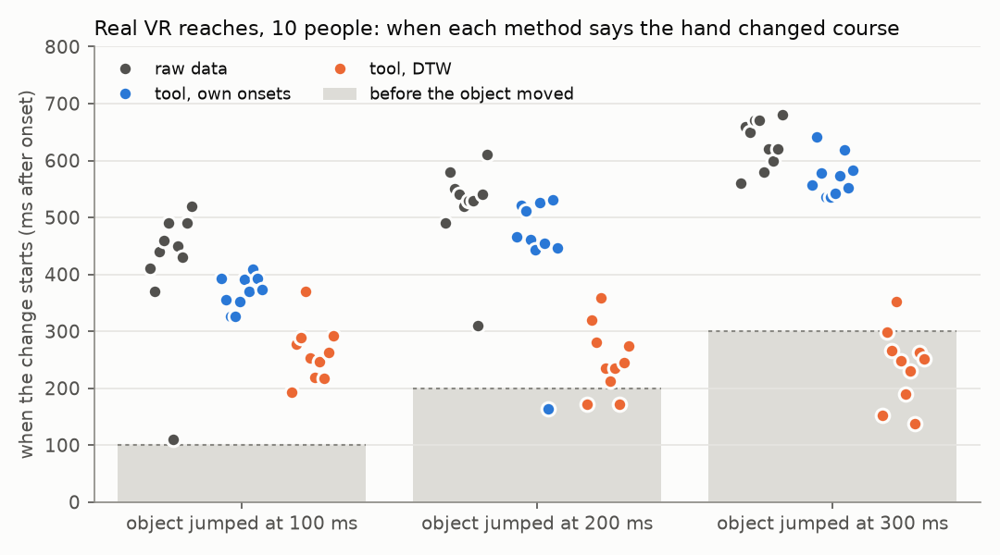

# Validation

Checks that the method measures what it claims, first on simulated data where the right answer is known, then on real VR reaches.

## Choosing the alignment

Reps have to be put on a shared timeline before they can be compared point by point, and the method used changes the answer. Four options were tested on three simulated changes, with six seeds each. The script is [benchmark_alignment.py](benchmark_alignment.py), and [alignment_benchmark.md](alignment_benchmark.md) has the full output.

| Alignment | Error on mid-reach bend | Error on undershoot | Undershoot, mid phase (true 0.031) | Timing change left over |
|---|---|---|---|---|
| Linear time only | 0.009 | 0.008 | 0.029 | 100% |
| DTW on position | 0.007 | 0.025 | 0.005 | 1-3% |
| DTW on velocity (default) | 0.010 | 0.012 | 0.032 | 20-23% |
| DTW on speed | 0.012 | 0.020 | 0.053 | 32-35% |

Errors are in torso lengths, about 50 cm.

- **Position DTW** erases most of an undershoot, because it slides the short reach along the long one until they match. Undershoot is what depth compression in a headset would cause, so this rules it out.
- **Linear time** reports a pure timing change as a change in path. A slower, more careful reach would show up as a fake shift.
- **Velocity DTW** is the only option that holds up in all three cases. It over-reads the end of an undershoot by about 19%.

Because no option wins everywhere, every summary also prints the shift computed with linear time. If the two agree, the change is in the path. If the linear one is much larger, part of it is timing.

## Bugs the simulation caught

1. **Fidgets counted as reps.** Candidates that travel less than half the median rep distance are now rejected and marked on the segmentation plot.
2. **Extra wobble looked like a shift.** Wobble at the start of a reach triggered the rep cut early, and the misaligned reps showed a significant fake shift later in the movement. Reps are now cut on speed along the main direction of the movement.
3. **An averaged template was distorted.** Averaging time-warped reps gave a speed profile no real reach has, and every rep was then aligned to it. The template is now one real baseline rep, retimed to average baseline timing.

## Real VR data

[fetch_furmanek2022.py](fetch_furmanek2022.py) downloads the data and [furmanek2022.py](furmanek2022.py) runs the check. Output is in [results/furmanek2022/](../results/furmanek2022/), and [summary.md](../results/furmanek2022/summary.md) has every participant.

The data come from Furmanek et al. (2022), released under CC0. Ten people reached to grasp a virtual object in an Oculus Rift DK2 while motion capture tracked the wrist, thumb and index finger at 75 Hz, resampled to 100 Hz. In the distance experiment the object sometimes jumped to a new distance 100, 200 or 300 ms after movement onset. The check compares reaches to the near object (20 cm, 34 to 89 per person) with reaches where it jumped from 20 cm to 40 cm (8 to 16 per person and jump time). Positions are projected onto the reach direction across the table and height, the plane a side camera would see. They go in through `movediff import` like any other CSV.

A response to the jump can only start after the jump, and should start later for later jumps. The reference is a plain comparison of the raw wrist positions on the dataset's own clock, with no cutting or alignment. The tool runs three ways.

- **Given onsets.** `import --onset-at-zero` keeps the dataset's onset times, then `--align-on onset`. This tests the pipeline alone.
- **Own onsets.** `import` finds each reach's onset, as it has to with video, then `--align-on onset`.
- **DTW.** Own onsets, then the default `--align-on velocity`.

All four use the same statistic and rule. Label shuffles give a 95% noise band at each time step. The change starts where the shift rises above the band and stays above it to the end of the window.

| | Raw data | Given onsets | Own onsets | DTW |
|---|---|---|---|---|
| Change found before the object moved (of 30) | 0 | 0 | 1 | 11 |
| Later jump read later (of 10 people) | 9 | 9 | 9 | 0 |
| Difference from raw data, median [range] | | 0 ms [-12, +47] | -70 ms [-164, +281] | -289 ms [-462, +109] |
| Fires on random halves of normal reaches | 4% | | 4% | |

**Given onsets** match the raw data to within 12 ms in 29 of 30 cases. Cutting, resampling and the statistics add no timing error of their own.

**Own onsets** read the change a median of 70 ms earlier than the raw data, for two reasons. Lining each reach up on its own start removes the jitter in when people begin to move. That makes the noise band about 40% narrower in the 300 ms after the jump (median ratio 0.59), so a change clears it sooner. And where the tool puts the jumped reaches' starts later than the near reaches' (by up to 78 ms in one person), it reads the change earlier, by about 1.4 ms per ms of difference. The jump can't cause a difference in when the reach started, so this is either chance in small trial sets or a limit of finding onsets from positions.

Two cases go the other way. For P8's 200 ms jump the tool reads 164 ms, before the jump. The raw data separate unusually early there too, at 310 ms against 490 to 610 ms for everyone else. For P6's 100 ms jump the raw data separate at 110 ms, far too soon to be a response. The jumped reaches in that set started about 27 ms earlier, and on the dataset's clock that looks like a change in path. Aligned on each reach's own start, the tool reads 391 ms.

**DTW** fails, as it did with one person. Normal reaches took 510 to 730 ms and jumped reaches 840 to 1,220 ms, 1.4 to 2.3 times as long. On a 0-100% timeline the same percentage is a different moment in each, so the tool compares different moments and finds a difference before the object moved in 11 of 30 cases. DTW matches on the shape of the velocity profile, and a two-part corrective reach has a different shape from a one-part reach, so warping can't fix it.

### What running all ten changed

The first version of this check used one person and looked fine. Running the other nine showed two problems.

1. **The rule for when a change starts.** It took the first 50 ms above the noise band. On random halves of normal reaches, where nothing changed, that fired 25% of the time on the raw data and 12% on the tool, so the clean result for one person was partly luck. The rule now needs the shift to stay above the band to the end of the window, which fires 4% of the time.
2. **The onset threshold, a bug in the tool.** It was 10% of each reach's own peak speed. Jumped reaches have a fast second movement, so their peak was higher, their threshold was higher, and their onsets came out later, by up to 89 ms. On a clock-time comparison that alone looks like a change, and the tool read changes up to 350 ms too early. The threshold is now one value for every trial in a file, or every rep in a video session. `tests/test_tabular.py` reproduces the old failure. The synthetic results above changed only in the third decimal place.

Also added:

- `--align-on onset` used to stop at the baseline's median duration, which cut off late corrections. It now runs to the longest median duration of any condition. A rep that has already ended holds its final position.
- `import --onset-at-zero`, for logs where t=0 already marks movement onset.
- The summary warns when test reps take more than 1.25x or less than 0.8x as long as baseline reps.

For the aftereffect experiment in PROTOCOL.md, baseline and test are the same reach, so durations should be close and DTW stays the default. The warning will say if they aren't.
